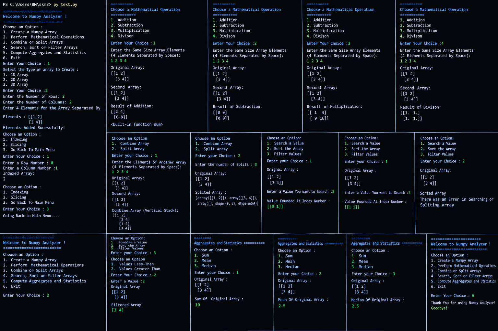

# NumPy Analyzer

A menu-driven Python command-line application for creating and manipulating NumPy arrays. It lets users explore array indexing, slicing, arithmetic operations, combining and splitting arrays, searching, sorting, filtering, and basic statistics.

## Features

- **Create arrays**
  - Create 1D, 2D, and 3D NumPy arrays.
  - Enter array dimensions and elements interactively.
- **Indexing and slicing**
  - Access an element by row and column.
  - Explore array slices.
- **Mathematical operations**
  - Addition
  - Subtraction
  - Element-wise multiplication
  - Element-wise division
- **Combine and split arrays**
  - Combine arrays using vertical stacking.
  - Split an array into a requested number of sections.
- **Search, sort, and filter**
  - Find the indices where a value occurs.
  - Sort array values.
  - Filter values using less-than or greater-than conditions.
- **Aggregates and statistics**
  - Sum
  - Mean
  - Median

## Requirements

- Python 
- NumPy
- Vs code
- Git
- Git Hub

## Installation

1. Install Python 3 from [python.org](https://www.python.org/downloads/) if it is not already installed.
2. (Optional) Create and activate a virtual environment:

   ```bash
   python -m venv .venv
   ```

   Windows PowerShell:

   ```powershell
   .\.venv\Scripts\Activate.ps1
   ```

   macOS/Linux:

   ```bash
   source .venv/bin/activate
   ```

3. Install NumPy:

   ```bash
   python -m pip install numpy
   ```

## Run the application

Save the program as `text.py`, then run it from the project directory:

```bash
python text.py
```

On Windows, this command may also work:

```powershell
py text.py
```

Follow the on-screen menus and enter the number corresponding to the operation you want.

## Example

For a 2D array with two rows and two columns, enter:

```text
1 2 3 4
```

The array is displayed as:

```text
[[1 2]
 [3 4]]
```

Example operations on this array:

| Operation | Result |
|---|---|
| Addition with the same array | `[[2 4], [6 8]]` |
| Subtraction from the same array | `[[0 0], [0 0]]` |
| Element-wise multiplication | `[[1 4], [9 16]]` |
| Element-wise division by the same nonzero array | `[[1. 1.], [1. 1.]]` |
| Sum | `10` |
| Mean | `2.5` |
| Median | `2.5` |

*The examples above show results in compact form; NumPy's actual terminal formatting may use multiple lines.*

## Main menu

1. Create a NumPy Array
2. Perform Mathematical Operations
3. Combine or Split Arrays
4. Search, Sort or Filter Arrays
5. Compute Aggregates and Statistics
6. Exit

## Notes and limitations

- Mathematical operations generally require arrays with compatible shapes.
- Division by zero should be handled to avoid invalid results.
- When splitting an array into more sections than it has rows, NumPy may return empty sections.
- Sorting behavior depends on how the program calls NumPy's sorting functions. If sorting reports an error, review the sorting branch in `text.py`.
- Input validation and error handling can be improved for invalid menu choices, incorrect element counts, and incompatible array dimensions.
- This README describes the behavior shown in the supplied terminal session; exact implementation details may vary.

## Project structure

```text
/
├── main.py
├── output.png
└── README.md
```

## Output 



## Author 

``Adnan``

